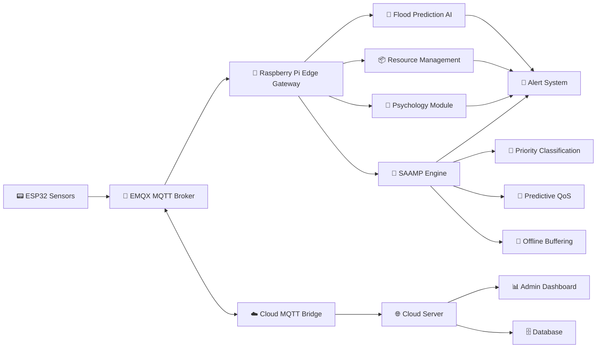

# 🌍 Smart Disaster Relief Camp Box (SDRC-Box)

<div align="center">


<br>


<br>


</div>

---

# 🌍 Project Vision

The **SDRC-Box** is an AI-powered disaster response ecosystem combining:

- 🌊 Flood prediction (Edge AI)
- 📡 MQTT messaging via **EMQX Broker**
- 📦 Smart resource management
- 🧠 Offline education + psychology support
- ☁️ Cloud analytics dashboard

It ensures **continuous operation even without internet**.

---

# ⚡ Smart System Workflow

<div align="center">



</div>

---

# 🛰 Live System Animation

<div align="center">


</div>

---

# 🏗 Core Modules

| Module | Description |
|---|---|
| 🌊 Flood Prediction | AI-based environmental forecasting |
| 📦 Resource Management | QR + real-time inventory system |
| 📡 MQTT System | EMQX broker message handling |
| 🧠 SAAMP | Adaptive QoS + priority routing |
| 🌐 Cloud Bridge | Real-time dashboard sync |
| 📱 React UI | Admin control panel |

---

# 🚀 Tech Stack

<div align="center">

| Layer | Technology |
|---|---|
| Frontend | React, Next.js |
| Backend | Node.js, Flask |
| MQTT Broker | EMQX |
| Edge AI | Raspberry Pi + TensorFlow Lite |
| IoT | ESP32 |
| Database | MongoDB / PostgreSQL |
| Communication | MQTT, WebSockets |

</div>

---

# 📁 Repository Structure

```bash
SmartCamp-IoT-AI-Framework/
│
├── cloud-platform/
├── edge-gateway/
├── raspberry-platform/
├── sensor-node/
├── .github/workflows/
├── Credentials.md
├── network_simulation_log.csv
└── README.md
```

---

# 🌟 Future Enhancements

- 🛰 Satellite communication support
- 🚁 Drone-based delivery system
- 🤖 AI crowd analysis
- 🔗 Blockchain aid tracking
- 🧠 Federated learning across regions

---

# ❤️ Final Message

<div align="center">


### 🌍 SDRC-BOX
**AI + IoT + Edge + Cloud for Humanitarian Intelligence**

</div>
