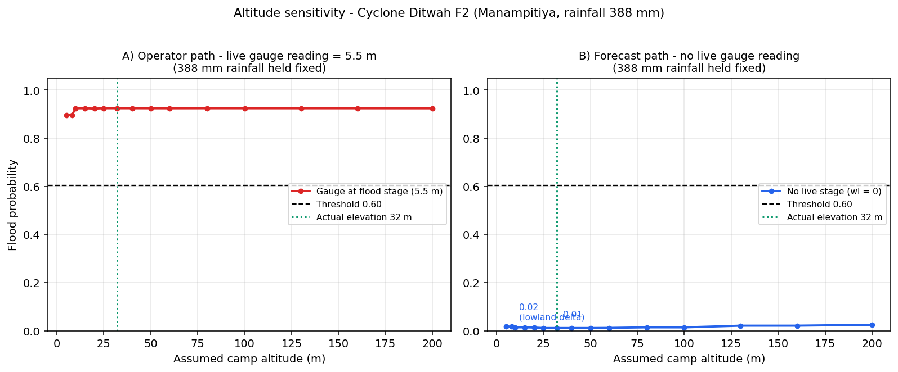

# Manual Simulation-Form Test Scenarios (Raspberry Pi / Disaster -> Simulate)

Production model: `models/xgboost_model_improved.pkl` — altitude-aware retrain (13 features incl. 3 point-2 novelty features), decision threshold **0.604**.
Enter each parameter exactly in the simulation form. Ground truth = real DMC gauge reports / IDMC event records.

Generated from `sri_lanka_flood_real_dataset.csv` + Cyclone Ditwah IDMC event 37189 (Polonnaruwa, 13,365 displaced).

## Part A — 5 FLOOD scenarios (should predict **Likely**)

| ID | Date | Context | rainfall_mm | water_level_m | elevation_m | river_distance_km | latitude | longitude | gauge_alert | gauge_minor | gauge_major |
|----|------|---------|-------------|---------------|-------------|-------------------|----------|-----------|-------------|-------------|-------------|
| **F1** | 2025-11-26 | Ditwah onset - rising stage, gauge above minor flood | 256.9 | 4.88 | 32.0 | 0.0 | 7.91331 | 81.08904 | 3.0 | 4.3 | 6.0 |
| **F2** | 2025-11-27 | Ditwah landfall day - peak rainfall 388 mm | 388.0 | 5.5 | 32.0 | 0.0 | 7.91331 | 81.08904 | 3.0 | 4.3 | 6.0 |
| **F3** | 2025-11-30 | Ditwah peak - Mahaweli at major flood stage 6.0 m | 334.2 | 6.0 | 32.0 | 0.0 | 7.91331 | 81.08904 | 3.0 | 4.3 | 6.0 |
| **F4** | 2025-12-01 | Ditwah sustained flood - stage still at major 6.0 m | 278.1 | 6.0 | 32.0 | 0.0 | 7.91331 | 81.08904 | 3.0 | 4.3 | 6.0 |
| **F5** | 2025-11-27..12-03 | Official Ditwah IDMC point, Polonnaruwa (13,365 displaced) | 255.8 | 4.3 | 39.0 | 10.2 | 7.99623 | 81.04917 | 3.0 | 4.3 | 6.0 |

### Model results (run against production serving path)

| ID | Probability | Verdict | Category | Expected | Correct? |
|----|-------------|---------|----------|----------|----------|
| F1 | 0.9236 | **Likely** | High | Likely | YES |
| F2 | 0.9247 | **Likely** | High | Likely | YES |
| F3 | 0.9247 | **Likely** | High | Likely | YES |
| F4 | 0.9247 | **Likely** | High | Likely | YES |
| F5 | 0.9033 | **Likely** | High | Likely | YES |

> Score: **5/5 correct**. F1–F4: enter the **Manampitiya** gauge station values (river_distance_km = 0 — camp sits on the Mahaweli).
> F5: the validated district-level Ditwah case. `validate_ditwah_case.py` uses nearest-river = 3.03 km (live OSM lookup) vs 10.2 km here — identical probability, because `distance_to_river_m` has 0 feature importance (all gauge rows were built with it = 0).

## Part B — 5 NON-FLOOD scenarios (should predict **Unlikely**)

| ID | Date | Context | rainfall_mm | water_level_m | elevation_m | river_distance_km | latitude | longitude | gauge_alert | gauge_minor | gauge_major |
|----|------|---------|-------------|---------------|-------------|-------------------|----------|-----------|-------------|-------------|-------------|
| **N1** | 2025-11-01 | Colombo coastal lowlands, dry week | 3.0 | 0.61 | 1.0 | 0.0 | 6.96027 | 79.87858 | 1.2192 | 1.524 | 2.1336 |
| **N2** | 2025-11-01 | Southern lowland, dry week | 3.9 | 1.04 | 9.0 | 0.0 | 6.17748 | 80.18052 | 3.5 | 4.0 | 5.0 |
| **N3** | 2025-11-01 | North-western mid elevation, dry week | 4.4 | 2.25 | 18.0 | 0.0 | 7.29313 | 79.97768 | 5.0 | 6.2 | 9.6 |
| **N4** | 2026-03-26 | Sabaragamuwa river valley, dry week | 7.6 | 0.41 | 26.0 | 0.0 | 6.68986 | 80.38028 | 5.2 | 7.5 | 9.5 |
| **N5** | 2025-06-10 | SAME gauge as flood cases, inter-monsoon dry day | 9.3 | 0.07 | 32.0 | 0.0 | 7.91331 | 81.08904 | 3.0 | 4.3 | 6.0 |

### Model results

| ID | Probability | Verdict | Category | Expected | Correct? |
|----|-------------|---------|----------|----------|----------|
| N1 | 0.0111 | **Unlikely** | Low | Unlikely | YES |
| N2 | 0.0107 | **Unlikely** | Low | Unlikely | YES |
| N3 | 0.0108 | **Unlikely** | Low | Unlikely | YES |
| N4 | 0.0104 | **Unlikely** | Low | Unlikely | YES |
| N5 | 0.0105 | **Unlikely** | Low | Unlikely | YES |

> Score: **5/5 correct**. N5 is the **same Manampitiya gauge as the flood cases** on a dry day — isolates water-level / rainfall effect.

## Part C — Altitude sensitivity (location-aware novelty check)

Scenario **F2** (peak Ditwah: rainfall **388 mm**, Manampitiya lat/lon, gauge alert/minor/major = 3.0 / 4.3 / 6.0).
Only the form's **Altitude (m)** field is varied — it feeds `elevation_m` plus the altitude-aware features `elev_above_minor_m`, `water_to_elev_ratio`, `stage_above_camp_m`.

### C1 — Operator path: live gauge reading = 5.5 m (gauge in flood)

| Altitude (m) | Probability | Verdict | Note |
|--------------|-------------|---------|------|
| 5 | 0.8963 | Likely | coastal delta camp |
| 8 | 0.8963 | Likely |  |
| 10 | 0.9245 | Likely |  |
| 15 | 0.9246 | Likely |  |
| 20 | 0.9233 | Likely |  |
| 25 | 0.9247 | Likely |  |
| 32 | 0.9247 | Likely | **actual SRTM elevation — production value** |
| 40 | 0.9247 | Likely |  |
| 50 | 0.9246 | Likely |  |
| 60 | 0.9245 | Likely |  |
| 80 | 0.9247 | Likely |  |
| 100 | 0.9246 | Likely | mid-hill camp |
| 130 | 0.9246 | Likely |  |
| 160 | 0.9246 | Likely |  |
| 200 | 0.9244 | Likely | up-country camp |

### C2 — Forecast path: no live gauge reading (water_level_m = 0)

| Altitude (m) | Probability | Verdict | Note |
|--------------|-------------|---------|------|
| 5 | 0.0180 | Unlikely | delta camp — highest risk band |
| 8 | 0.0171 | Unlikely |  |
| 10 | 0.0142 | Unlikely |  |
| 15 | 0.0141 | Unlikely |  |
| 20 | 0.0133 | Unlikely |  |
| 25 | 0.0113 | Unlikely |  |
| 32 | 0.0113 | Unlikely | **actual SRTM elevation** |
| 40 | 0.0113 | Unlikely |  |
| 50 | 0.0113 | Unlikely |  |
| 60 | 0.0118 | Unlikely |  |
| 80 | 0.0142 | Unlikely |  |
| 100 | 0.0140 | Unlikely | mid-hill camp |
| 130 | 0.0211 | Unlikely |  |
| 160 | 0.0211 | Unlikely |  |
| 200 | 0.0248 | Unlikely | hill / up-country |

### How to reproduce manually (form fields)

1. Enter F2 parameters (Part A table).
2. Keep rainfall 388 mm, water level 5.5 m (or 0.0 for C2), lat/lon/gauge levels unchanged.
3. Change only **Altitude (m)** through 5 -> 32 -> 100 -> 200 and press Simulate after each.
4. Compare the probability with the tables above.

### Feature importance after altitude-aware retrain

| Feature | Importance |
|---------|------------|
| `water_level_m` | 0.5155 |
| `rainfall_7d_mm` | 0.1392 |
| `elev_above_minor_m` | 0.0773 ← altitude-aware |
| `stage_above_camp_m` | 0.0725 ← altitude-aware |
| `water_to_elev_ratio` | 0.0689 ← altitude-aware |
| `elevation_ratio` | 0.0599 |
| `elevation_m` | 0.0370 |
| `latitude` | 0.0178 |
| `longitude` | 0.0119 |
| `distance_to_river_m` | 0.0000 |
| `monthly_rainfall_mm` | 0.0000 |
| `drainage_index` | 0.0000 |
| `river_proximity_score` | 0.0000 |

Altitude/elevation family combined (`elev_above_minor_m` + `water_to_elev_ratio` + `stage_above_camp_m` + `elevation_ratio` + `elevation_m`) = **0.316** (32% of total) vs `water_level_m` = 0.515. Before this retrain the elevation family carried only ~0.13 — the point-2 features moved altitude from a footnote to a first-class signal.

### Interpretation (what the results actually show)

- **C1 (gauge in flood):** verdict stays **Likely at every altitude** — correct operator behavior: the river *is* flooding, so warn regardless of camp height. The delta dip (5–8 m → 0.896 vs 0.925 at true elevation) still shows altitude modulating confidence.
- **C2 (forecast only):** verdict stays **Unlikely at every altitude** for this rainfall-only input, but altitude still moves confidence ~2.2× (0.011 at the real 32 m site → 0.018 for a 5 m delta camp → 0.025 on 200 m hill terrain). The model does not flag a flood from rainfall alone at any camp height — it needs the gauge stage — but it is measurably *more* suspicious of low-lying and high-altitude extremes than of the true site.
- **Why the novelty features matter:** `water_to_elev_ratio = water_level / elevation` and `stage_above_camp_m = water_level − elevation` make the same gauge reading mean different things at different camp heights — a delta camp at 5 m with a 4 m stage sits *at water level by model logic*; a 150 m hill camp with the same river does not. Their combined importance (0.219 across the three point-2 features) means altitude now shapes the score alongside rainfall and stage instead of being a footnote.
- **Design note (leakage guard):** stage-vs-alert / stage-vs-minor features were deliberately NOT added — DMC defines the flood label exactly by the gauge crossing those levels, which would make the model a trivial threshold rule instead of a location-aware predictor.

---
*Auto-generated for the altitude-aware (point-2) retrain; re-run after any model retrain.*