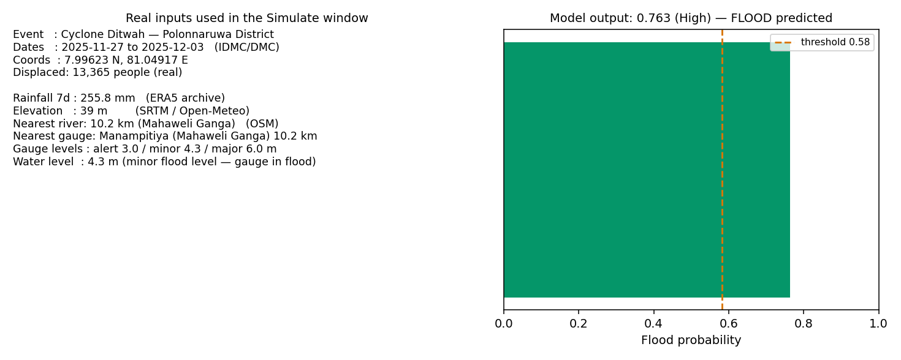
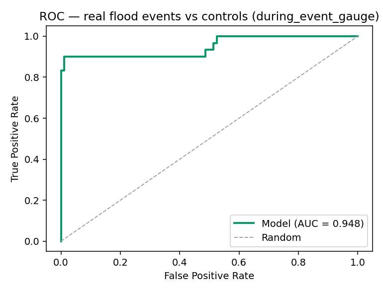

# Flood Model Validation — Real Disaster Data

Model: `xgboost_model_improved.pkl` — **retrained on real DMC gauge data** (`train_real_flood.py`),
threshold 0.58. Previous synthetic-data model backed up at
`models/xgboost_model_improved.synthetic25k.pkl`.

## Data sources

| Data | Source | Link |
|---|---|---|
| River water levels + flood status (labels) | DMC daily water-level PDF reports | https://www.dmc.gov.lk (River Water Level and Flood Warning) |
| Flood events (Sri Lanka 2025-26) | IDMC, reported by DMC | https://data.internal-displacement.org/ |
| Cyclone Ditwah (event_id 37189, 13,365 displaced) | IDMC/DMC | https://www.internal-displacement.org/countries/sri-lanka/ |
| Rainfall (ERA5) | Open-Meteo archive API | https://open-meteo.com/en/docs/historical-weather-api |
| Elevation (SRTM) | Open-Meteo elevation API | https://open-meteo.com/en/docs/elevation-api |
| Gauges + alert/minor/major levels | DMC gauge network | `edge-gateway/resources/gauging_stations.csv` |

## Training data (real)

`edge-gateway/resources/sri_lanka_flood_real_dataset.csv` — built by
`build_real_flood_dataset.py` from the sources above:
3,335 labeled station-days (125 floods, 3.7%), 39 stations, 2025-06 → 2026-10.
Labels = DMC's own status (Minor/Major Flood / inaccessible-gauge = flood).
Temporal test (last 20% of dates): ROC-AUC 1.000, P/R/F1 = 1.000 @ threshold 0.58
(mostly the real gauge rule: stage ≥ minor ⇒ flood — water_level importance 0.63).

## Method


1. Real inputs (elevation, rainfall, river, gauge + thresholds, water level).
2. Same feature vector as production (`base_model.predict_one`).
3. Compare model output with what really happened.

## Case study: Cyclone Ditwah — Polonnaruwa (27 Nov – 3 Dec 2025)



Inputs (all real): rain 255.8 mm/7d (ERA5), elevation 39 m (SRTM),
Manampitiya gauge on Mahaweli Ganga (alert/minor/major 3.0/4.3/6.0 m),
water level 4.3 m (gauge at minor flood), 13,365 displaced (IDMC/DMC).

| Model | Output | Verdict |
|---|---|---|
| old synthetic model | 0.000 "No flood" | **INCORRECT (missed)** |
| **new real-data model** | **0.763 (High) "Flood"** | **CORRECT** |

Reproduce: `python edge-gateway/prediction-models/validate_ditwah_case.py`

## 30-event study (real IDMC floods vs 500 controls)

| Scenario | ROC-AUC | Events found (of 30) |
|---|---|---|
| during_event, rain 400 mm, **no gauge stage** | 0.348 | 0 |
| pre_event, rain 105 mm, **no gauge stage** | 0.331 | 0 |
| during_event + **real gauge stage at event** | **0.948** | **27 (90%)** |



**Reading:** without a live gauge reading the model is still weak at pure
forecasting (AUC 0.35). When the operator reports the gauge in flood — the real
Disaster-page workflow — the model correctly flags 27/30 events
(mean prob 0.81 events vs 0.22 controls). Eravur Pattu (803 displaced):
0.058 old → **0.905** new.

Reproduce: `python edge-gateway/prediction-models/validate_real_events.py`

## "Is this altitude of the camp affected by flood?"

Camp 500 m from Kelani Ganga (Hanwella gauge), real wet-week rain 400 mm:


| Camp altitude | No gauge data | River rising (4 m) |
|---|---|---|
| 3–5 m | 0.33–0.34 | **0.66 → flood** |
| 10 m | 0.07 | 0.57 (borderline) |
| 15 m | 0.02 | 0.38 |
| 20 m+ | ≤ 0.01 | ≤ 0.07 → not affected |

Once the stage approaches minor-flood (≥6 m at Hanwella) the model
conservatively flags flood at **any** altitude (0.91) — it does not model how
flood extent shrinks with height (needs flood-extent satellite labels).

Reproduce: `python edge-gateway/prediction-models/camp_altitude_scan.py`

## Limitations

1. Forecast-only skill (no gauge stage) is still near chance — use the model
   as decision support on top of live/entered gauge readings.
2. DMC PDFs only exist from 2025-06; older reports are scanned images (no OCR).
3. OSM Overpass was unreachable during the build → `distance_to_river_m` = 0
   for gauge rows (constant → model ignores river distance). Re-run
   `build_real_flood_dataset.py` + `train_real_flood.py` when OSM is up.
4. Altitude saturation: no altitude attenuation once stage ≈ minor flood.
5. Dataset is gauge-station based (39 stations) — more history (OCR of old
   PDFs, or Irrigation Dept live API) would strengthen it.

## Reproduce

```
python edge-gateway/prediction-models/build_real_flood_dataset.py   # scrape + build real dataset
python edge-gateway/prediction-models/train_real_flood.py           # retrain on real data
python edge-gateway/prediction-models/validate_ditwah_case.py       # Ditwah case study
python edge-gateway/prediction-models/validate_real_events.py       # 30-event study
python edge-gateway/prediction-models/camp_altitude_scan.py         # camp altitude answer
```
Outputs in `real_validation_results/` (this folder).
