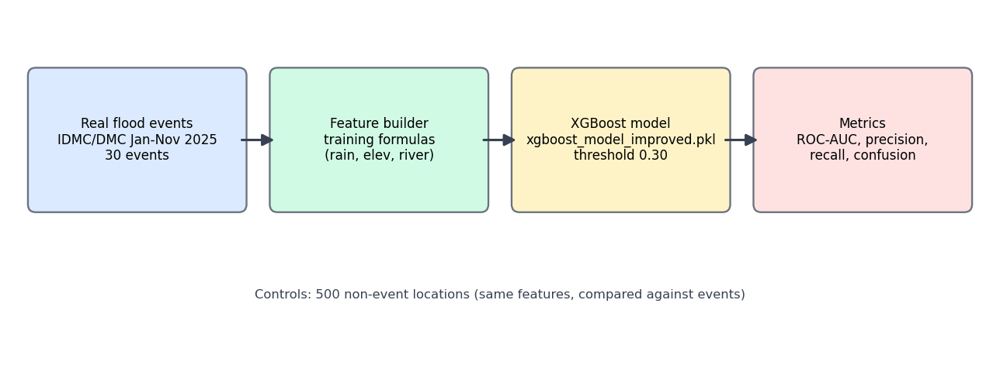
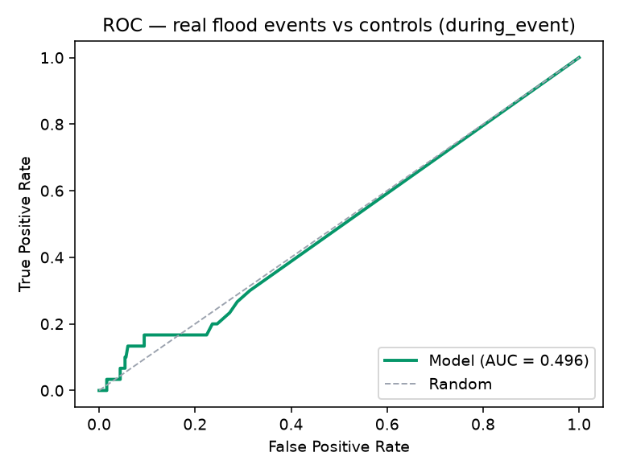
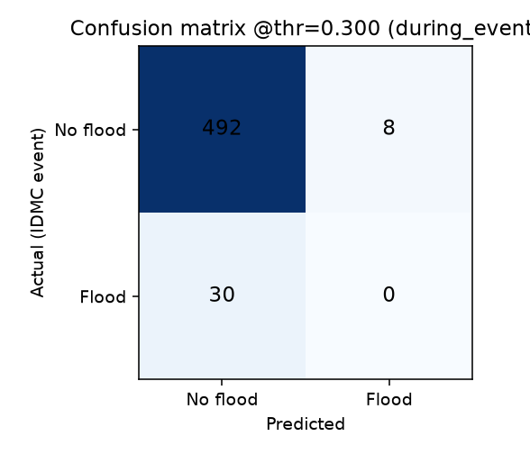
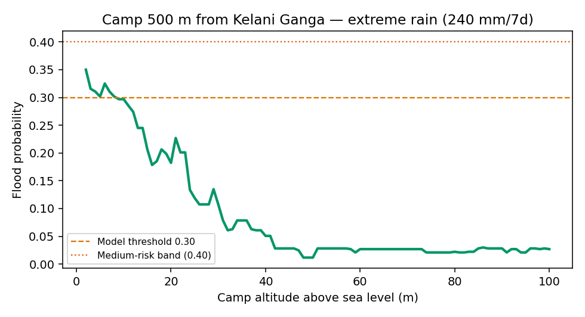

# Flood Model Validation — Real Disaster Data

Model: `xgboost_model_improved.pkl` (threshold 0.30)
Script: `edge-gateway/prediction-models/validate_real_events.py`
Run: `python edge-gateway/prediction-models/validate_real_events.py`

## Data sources

| Data | Source | Link |
|---|---|---|
| Real flood events (30, Sri Lanka 2025) | IDMC, reported by DMC Sri Lanka | https://data.internal-displacement.org/ (dataset: Internal Displacement Events, iso3 = LKA) |
| Country profile | IDMC Sri Lanka | https://www.internal-displacement.org/countries/sri-lanka/ |
| National disaster authority | Disaster Management Centre (DMC) | https://www.dmc.gov.lk/ |
| Gauging stations (43) | `edge-gateway/resources/gauging_stations.csv` | real station names + alert/minor/major levels |
| Training data (25,000 rows) | `edge-gateway/resources/sri_lanka_flood_risk_dataset_25000.csv` | synthetic (marked `is_synthetic=True`) |

Local files: events CSV = `cloud-platform/prediction-models/resource-model/lka_idmc_idu_events.csv`.

## Method



Every event location is scored twice:
**during_event** = rainfall 169 mm/7d (Q75 of flood rows). **pre_event** = rainfall 64 mm (median of non-flood rows).

## A. Historical validation result

| Scenario | ROC-AUC | Precision | Recall | Events found (of 30) |
|---|---|---|---|---|
| during_event | 0.496 | 0.00 | 0.00 | 0 |
| pre_event | 0.499 | 0.00 | 0.00 | 0 |

Chance level = 0.50. **The model cannot separate real flood places from normal places.**




## B. Proof: one historical event you can check manually

**Event:** Flood — Batticaloa (Eravur Pattu), Sri Lanka
**Dates:** 13–24 January 2025 (part of the Jan 2025 Sri Lanka floods)
**Coordinates:** 7.7855 N, 81.6046 E
**People displaced:** 803 (DMC, via IDMC — check on https://data.internal-displacement.org/ )
**Model output (during_event):** probability = **0.058** → below 0.30 → model predicted **"No flood"**
**Real outcome:** flood happened, 803 displaced.
**Verdict: incorrect prediction (missed).** Full per-event list with probabilities: `real_validation_results/per_event_predictions.csv`.

Internal metrics on synthetic test data look strong (AUC 0.95, recall 0.71) — but that is the same synthetic data family. On the real event above, the model fails. This gap is the main finding.

## C. "Is this altitude of the camp affected by flood?"

Worked case: camp **500 m from Kelani Ganga** (near Nagalagam gauge, 6.9155 N 79.9732 E), extreme rain 240 mm/7d.



| Camp altitude | Model probability | Answer |
|---|---|---|
| 3–5 m | 0.30–0.35 | **Yes — above decision threshold, flood possible** |
| 10 m | 0.30 | borderline |
| 15–20 m | 0.18–0.21 | No |
| 30 m | 0.11 | No |
| 50 m+ | < 0.05 | No |

**Direct answer: below ~10 m altitude the model says the camp can be affected; from ~15 m upward it says not affected.** Lower altitude + closer to river + more rain = higher probability.

## Limitations

1. Training data is synthetic — real-event accuracy is unproven (AUC 0.50 here).
2. Elevation/river-distance values come from the synthetic set, not a real DEM.
3. Event data is district-level displacement, not flood maps.
4. Treat output as a relative risk score, not a real flood probability.

## Reproduce everything

```
python edge-gateway/prediction-models/validate_real_events.py
```
Outputs: `real_validation_results/` (metrics JSON, per-event CSV, all PNGs in this report).
